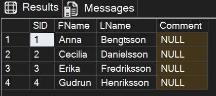
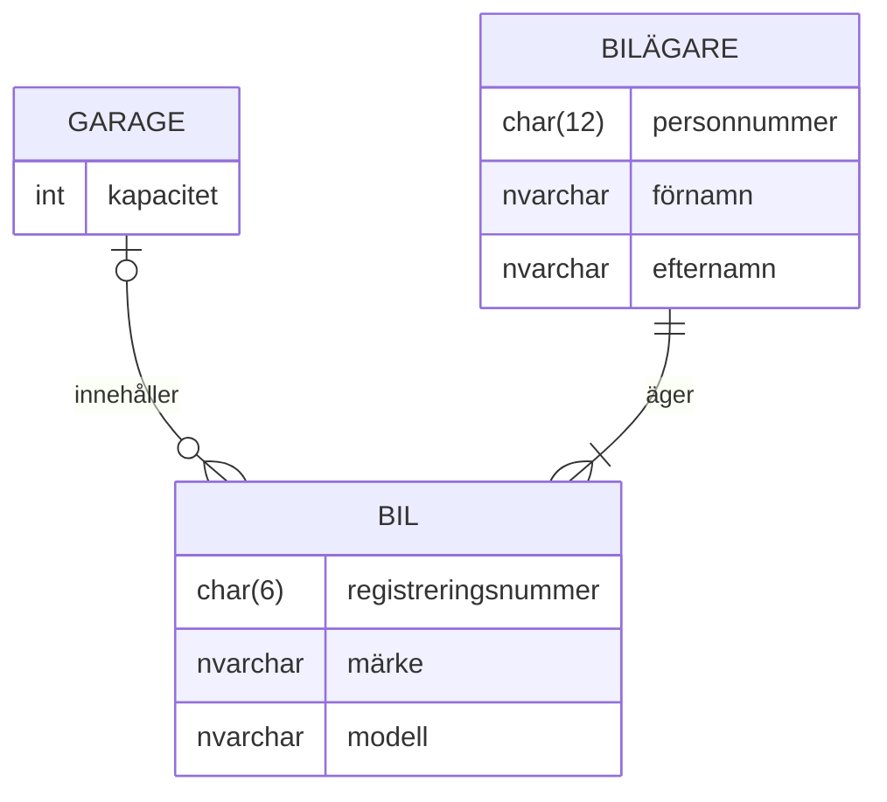
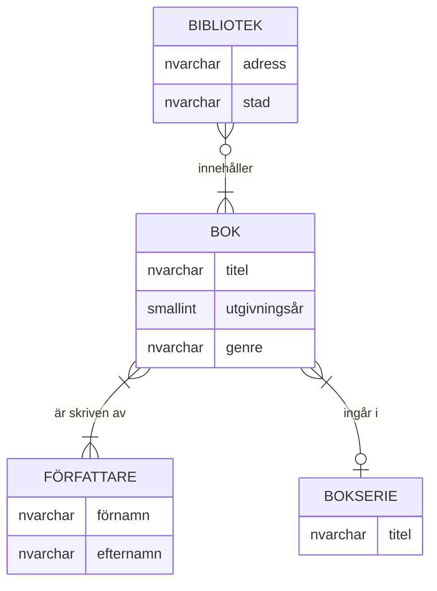
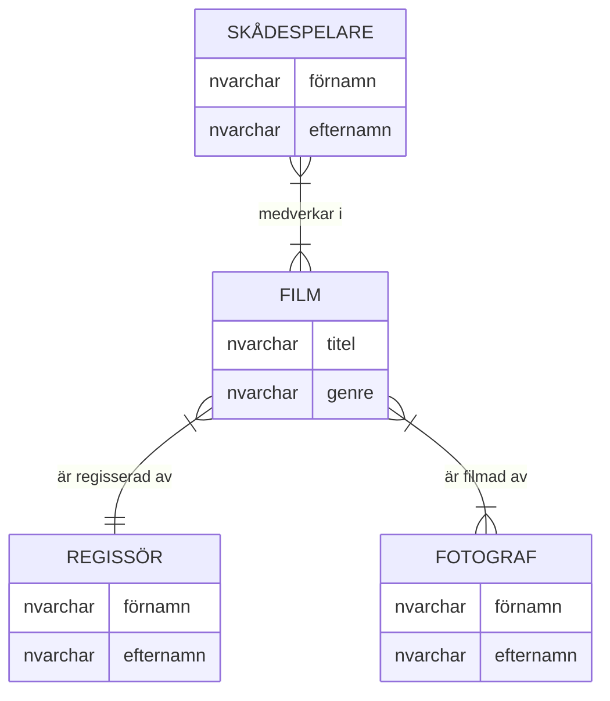
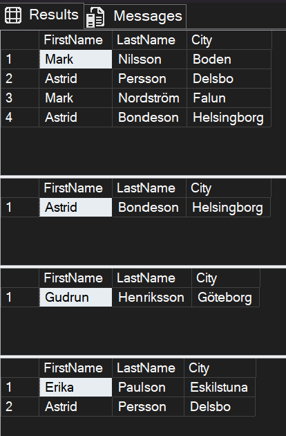
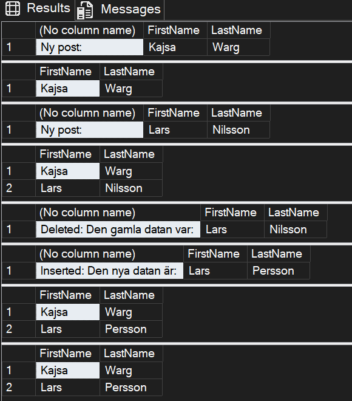
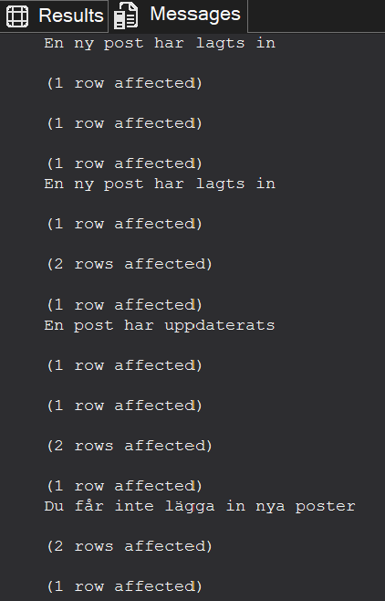
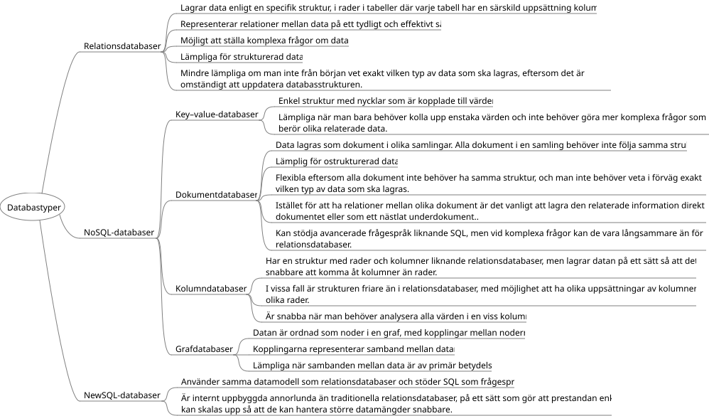

# Övning 1

Inlämnades tidigare: https://github.com/KuraSkymning/Lexicon-Databaser/tree/master/Bil%C3%A4gare.

# Övning 2

Skapa en databas som heter School.
I denna databas ska du skapa en tabell med studenter i SQL.
Den ska ha följande kolumner:

| Namn    | TYP         | Måste ha värde? | Primärnyckel? |
| ---     | ---         | ---             | ---           |
| SID     | int         | Ja              | Ja            |
| FName   | Varchar(20) | ja              | nej           |
| LName   | Varchar(20) | ja              | nej           |
| Comment | Text        | nej             | nej           |

Lägg in minst 3 studenter.

```
CREATE DATABASE School;
GO
USE School;
GO

CREATE TABLE Student
(SID int NOT NULL PRIMARY KEY,
FName varchar(20) NOT NULL,
LName varchar(20) NOT NULL,
Comment text);

INSERT INTO Student (SID, FName, LName)
VALUES (1, 'Anna', 'Bengtsson');
INSERT INTO Student (SID, FName, LName)
VALUES (2, 'Cecilia', 'Danielsson');
INSERT INTO Student (SID, FName, LName)
VALUES (3, 'Erika', 'Fredriksson');
INSERT INTO Student (SID, FName, LName)
VALUES (4, 'Gudrun', 'Henriksson');

SELECT * FROM Student;
```



# Övning 3

1. Beskriv vad lastbalansering innebär (i allmänhet, behöver inte gälla just databaser)
    * Att fördela lasten/arbetet över flera enheter så att inte bara en enhet måste göra allt.
2. Ge ett konkret exempel på där lastbalansering kan vara bra att använda.
    * En databas som används av många användare. Med lastbalansering blir den inte överbelastad lika lätt.
3. Anta att du bygger en hemsida. Vilka fördelar finns med använda lastbalansering? Ange tre fördelar
    * Kortare svarstider för besökare ifall många besöker sidan samtidigt, eftersom det är mindre risk för överbelastning.
    * Högre tolerans mot störningar: om en server skulle krascha eller vara nere för underhåll, finns det fortfarande andra som kan utföra samma arbete.
    * Flexiblare att skala upp och ner prestandan efter behov.
4. Vad är SQL Server Replication?
    * Att man har flera databaser med samma innehåll som är synkroniserade med varandra, så att uppdateringar i en av dem även överförs till de andra.
5. Vad är Mirroring i SQL Server?
    * Att man har en huvuddatabas vars innehåll överförs till andra kopior av databasen. Till skillnad från vid replikering är det bara huvuddatabasen som är aktiv.
6. Vad är Always On Availability Groups i SQL Server?
    * Ett sätt att konfigurera databaser så att de använder en form av replikering för hög tillgänglighet, katastrofåterställning och lastbalansering av läsoperationer.

# Övning 4

Studera de olika ER-modellerna på denna sida:
https://www.tpointtech.com/dbms-er-model-concept

Testa att göra egna modeller inom olika områden.

## Bilar



## Böcker



## Filmer



# Övning 5

Skapa en lagrad procedur som hämtar ut alla kunder som heter ’Mark’ eller ’Astrid’ sorterat fallande på förnamn.

Anropa proceduren.

```
CREATE DATABASE Customers;
GO
USE Customers;
GO

CREATE TABLE Customer
(ID int NOT NULL PRIMARY KEY,
FirstName varchar(20) NOT NULL,
LastName varchar(20) NOT NULL,
City text);

INSERT INTO Customer (ID, FirstName, LastName, City)
VALUES (1, 'Anna', 'Bengtsson', 'Alingsås');
INSERT INTO Customer (ID, FirstName, LastName, City)
VALUES (2, 'Mark', 'Nilsson', 'Boden');
INSERT INTO Customer (ID, FirstName, LastName, City)
VALUES (3, 'Cecilia', 'Danielsson', 'Charlottenberg');
INSERT INTO Customer (ID, FirstName, LastName, City)
VALUES (4, 'Astrid', 'Persson', 'Delsbo');
INSERT INTO Customer (ID, FirstName, LastName, City)
VALUES (5, 'Erika', 'Paulson', 'Eskilstuna');
INSERT INTO Customer (ID, FirstName, LastName, City)
VALUES (6, 'Mark', 'Nordström', 'Falun');
INSERT INTO Customer (ID, FirstName, LastName, City)
VALUES (7, 'Gudrun', 'Henriksson', 'Göteborg');
INSERT INTO Customer (ID, FirstName, LastName, City)
VALUES (8, 'Astrid', 'Bondeson', 'Helsingborg');
GO

CREATE PROC getMarkAndAstrid AS 
SELECT FirstName, LastName, City FROM Customer
WHERE FirstName = 'Mark' OR FirstName = 'Astrid';
GO

EXEC getMarkAndAstrid;
```

Se bild efter övning 6.

# Övning 6

Gör en lagrad procedur som tar en inparameter.
Om man inte anropar med värde ska det finnas ett default värde.

A. Gör en inparameter som är valfri. Kan vara t.ex. namn.
Frågan ska ge ett resultat och namnet på frågan ska spegla vad det önskade resultatet är.

```
CREATE PROC getCustomersWithLastName
@lastname varchar(20) = 'Bondeson'
AS
SELECT FirstName, LastName, City FROM Customer
WHERE LastName = @lastname
ORDER BY LastName, FirstName;
GO

EXEC getCustomersWithLastName;

EXEC getCustomersWithLastName 'Henriksson';
```

B. Gör en lagrad procedur som hämtar alla kunder vars efternamn börjar på ’P’.

Visa även hur du anropar proceduren.

```
CREATE PROC getCustomersWithLastNamesP
AS
SELECT FirstName, LastName, City FROM Customer
WHERE LastName LIKE 'P%'
ORDER BY LastName, FirstName;
GO

EXEC getCustomersWithLastNamesP;
```

Gemensam bild för övning 5 och 6:



# Övning 7

```
CREATE DATABASE TriggerDB;
GO
USE TriggerDB;
GO

CREATE TABLE testTrigger(
FirstName varchar (50),
LastName varchar (50));
GO

CREATE TRIGGER info
ON testTrigger
FOR INSERT
AS
Print 'En ny post har lagts in'
SELECT 'Ny post: ', * FROM inserted
SELECT * FROM testTrigger;
GO

INSERT INTO testTrigger
VALUES ('Kajsa', 'Warg');
INSERT INTO testTrigger
VALUES ('Lars', 'Nilsson');
GO

CREATE TRIGGER modify
ON testTrigger
FOR UPDATE
AS
Print 'En post har uppdaterats'
SELECT 'Deleted: Den gamla datan var: ', * FROM deleted
SELECT 'Inserted: Den nya datan är: ', * FROM inserted
SELECT * FROM testTrigger;
GO

UPDATE testTrigger
SET LastName = 'Persson'
WHERE FirstName = 'Lars';
GO

CREATE TRIGGER stopInsert
ON testTrigger
INSTEAD OF INSERT
AS
Print 'Du får inte lägga in nya poster'
SELECT * FROM testTrigger;
GO

INSERT INTO testTrigger
VALUES('Kaisa', 'Varg');
```




# Övning 8



* Relationsdatabaser
    - Lagrar data enligt en specifik struktur, i rader i tabeller där varje tabell har en särskild uppsättning kolumner.
    - Representerar relationer mellan data på ett tydligt och effektivt sätt.
    - Möjligt att ställa komplexa frågor om datan.
    - Lämpliga för strukturerad data.
    - Mindre lämpliga om man inte från början vet exakt vilken typ av data som ska lagras, eftersom det är omständigt att uppdatera databasstrukturen.


* NoSQL-databaser
    - Key–value-databaser
        * Enkel struktur med nycklar som är kopplade till värden.
        * Lämpliga när man bara behöver kolla upp enstaka värden och inte behöver göra mer komplexa frågor som berör olika relaterade data.

    - Dokumentdatabaser
        * Data lagras som dokument i olika samlingar. Alla dokument i en samling behöver inte följa samma struktur.
        * Lämplig för ostrukturerad data.
        * Flexibla eftersom alla dokument inte behöver ha samma struktur, och man inte behöver veta i förväg exakt vilken typ av data som ska lagras.
        * Istället för att ha relationer mellan olika dokument är det vanligt att lagra den relaterade information direkt inuti dokumentet eller som ett nästlat underdokument.
        * Kan stödja avancerade frågespråk liknande SQL, men vid komplexa frågor kan de vara långsammare än för relationsdatabaser.

    - Kolumndatabaser
        * Har en struktur med rader och kolumner liknande relationsdatabaser, men lagrar datan på ett sätt så att det är snabbare att komma åt kolumner än rader.
        * I vissa fall är strukturen friare än i relationsdatabaser, med möjlighet att ha olika uppsättningar av kolumner för olika rader.
        * Är snabba när man behöver analysera alla värden i en viss kolumn.

    - Grafdatabaser
        * Datan är ordnad som noder i en graf, med kopplingar mellan noderna.
        * Kopplingarna representerar samband mellan datan.
        * Lämpliga när sambanden mellan data är av primär betydelse.

* NewSQL
    - Använder samma datamodell som relationsdatabaser och stöder SQL som frågespråk.
    - Är internt uppbyggda annorlunda än traditionella relationsdatabaser, på ett sätt som gör att prestandan enklare kan skalas upp så att de kan hantera större datamängder snabbare.
